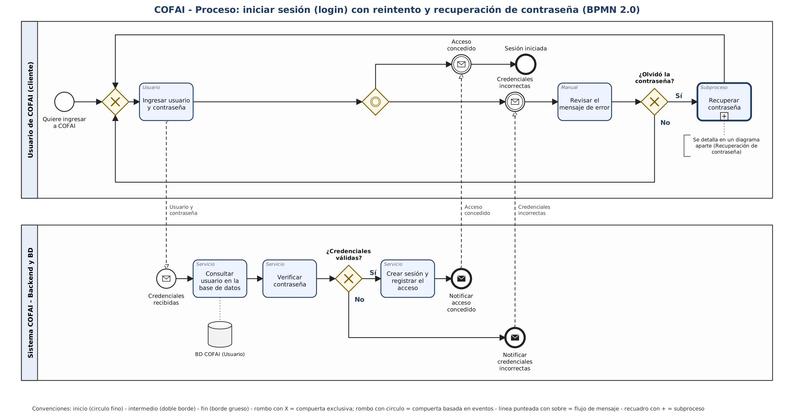
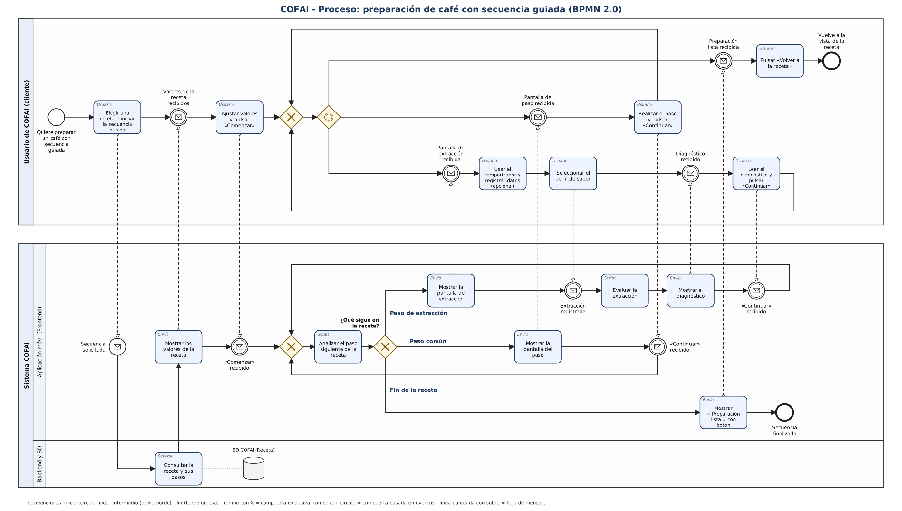
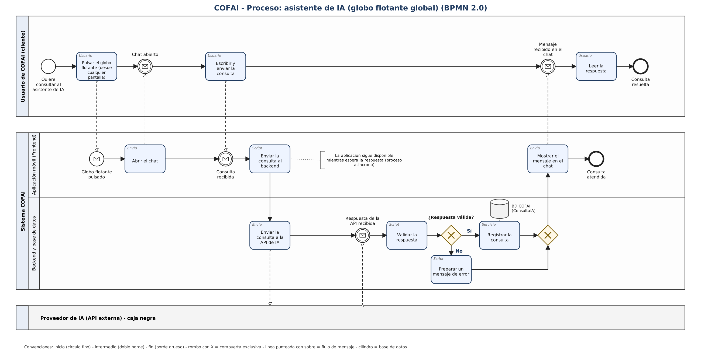

# COFAI — Aplicación de café de especialidad

> Trabajo Práctico Integrador y Progresivo (TPI)
> Organización Empresarial · Tecnicatura Universitaria en Programación a Distancia · UTN

**Cofia** es una aplicación Expo + React Native Web para explorar métodos de café, usar una calculadora de recetas, guardar recetas propias y consultar un asistente de IA. Fue pensada para Café Delirante (tostadora y cafeterías de especialidad de Bariloche) y acerca el café de especialidad a quienes recién empiezan.

## Enlaces

- Repositorio público: [https://github.com/FrancoPeron/delirante-cofai-tup](https://github.com/FrancoPeron/delirante-cofai-tup)
- Tablero ágil (GitHub Projects): https://github.com/users/FrancoPeron/projects/2

## Integrantes

| Integrante | Usuario de GitHub | Rol |
|---|---|---|
| Franco Matías Perón Mora | [@FrancoPeron](https://github.com/FrancoPeron) | Líder de proyecto, desarrollo Frontend e integración de IA |
| matko841 | [@matko841](https://github.com/matko841) | Backend y base de datos, QA y revisión de código |

> Equipo reducido a efectos del TPI: el segundo integrante corresponde a una segunda cuenta utilizada para la revisión de pares.

**Docente titular:** Prof. Gabriela Martínez · **Docente tutor:** Pablo García

## Stack

- Expo, React 19, React Native / React Native Web
- TypeScript
- Firebase Auth
- Express (proxy/backend local)
- Gemini API, accedida a través del backend

## Scripts

| Comando | Qué hace |
|---|---|
| `npm run dev` | Inicia Expo |
| `npm run web` | Inicia Expo en web |
| `npm run android` / `npm run ios` | Inicia Expo para Android / iOS |
| `npm run server` | Inicia el backend local (`server/index.js`) |
| `npm run lint` | Ejecuta `tsc --noEmit` |
| `npm run export:web` | Exporta el build web estático |
| `npm run export:android` | Exporta assets para Android |
| `npm run export:all` | Exporta la app completa con Expo |

## Ejecutar localmente

Requisitos: Node.js y npm.

1. Instalar dependencias: `npm install`
2. Crear `.env.local` en la raíz con al menos:
   ```
   EXPO_PUBLIC_API_BASE_URL=http://localhost:8787
   GEMINI_API_KEY=tu_api_key
   REQUIRE_FIREBASE_AUTH=false
   ```
3. Iniciar el backend: `npm run server`
4. Iniciar la app: `npm run dev` (o `npm run web` para web)

**Producción**
- `GEMINI_API_KEY` debe vivir solo en el servidor; nunca en el cliente.
- Para exportar, definí `EXPO_PUBLIC_API_BASE_URL` apuntando al backend público.
- Con Firebase Auth en el backend, activá `REQUIRE_FIREBASE_AUTH=true` y configurá las credenciales del servicio.
- En el emulador de Android usá `http://10.0.2.2:8787` si `localhost` no responde.

## Estructura del proyecto

```
.
├── App.tsx                 # Shell principal: navegación, estado global, timer, asistente
├── App.styles.ts           # Estilos del shell
├── AppLogic.tsx            # Prototipo/legado de lógica UI (no es la entrada actual)
├── index.tsx               # Arranque de la app
├── types.ts                # Tipos y constantes compartidas
├── constants.tsx           # Constantes de UI y globales
├── components/
│   ├── pages/
│   │   ├── Home/           # Portada
│   │   ├── Tools/          # Calculadora, cafetera y carrusel de recetas
│   │   ├── Assistant/      # Chat con IA
│   │   ├── AddRecipe/      # Alta y edición de recetas
│   │   ├── Profile/        # Perfil, favoritos y recetas propias
│   │   ├── ViewAll/        # Listados completos
│   │   └── MethodDetail/   # Detalle de un método
│   └── ui/                 # RecipeCard, CoffeeMakerCard, ExtractionMethodCard, Typography
├── data/                   # catalog.ts (recetas, cafeteras, métodos) y news.ts
├── services/               # geminiService, firebaseAuthService, googleDriveBackupService, newsService
├── server/index.js         # Backend/proxy local para IA y flujos protegidos
├── assets/                 # Imágenes y fuentes
└── docs/
    ├── bpmn/               # Diagramas de procesos (.png)
    └── entregas/           # Entregas 1 a 3 (PDF)
```

**Cómo se relaciona con la organización de COFAI (Entrega 3)**

| Área | Dónde vive en el código |
|---|---|
| Frontend e integración de IA | `App.tsx`, `components/`, `services/geminiService.ts` |
| Backend y base de datos | `server/index.js`, `services/firebaseAuthService.ts`, `data/` |
| Servicio externo de IA | Gemini API, consumida solo desde el backend |

**Convenciones**
- El estado global principal vive en `App.tsx`.
- Tools tiene componentes propios cuando no conviene reutilizar la UI global.
- La IA consume el backend definido por `EXPO_PUBLIC_API_BASE_URL`.
- Las recetas de usuario se gestionan en el estado local y con backup/restauración en JSON.

## Modelado de procesos (BPMN 2.0)

Se modelaron los tres procesos principales como diagramas independientes.

### 1. Inicio de sesión


El usuario ingresa sus credenciales, se validan y se concede o deniega el acceso. Si olvidó su contraseña, se inicia la recuperación.

### 2. Preparación de café (secuencia guiada)


Configuración inicial, ciclo de pasos guiados (pasos comunes y paso de extracción con diagnóstico instantáneo) y cierre con "¡Preparación lista!".

### 3. Asistente de IA (globo flotante global)


Desde cualquier pantalla el usuario abre el chat y envía una consulta. El backend la envía a la API externa de IA, valida la respuesta y la registra; si no es válida, se muestra un mensaje de error.

## Flujo de trabajo con Git

- `main` solo recibe cambios por Pull Request.
- Ramas secundarias con prefijo: `docs/…`, `feat/…`, `fix/…`.
- Commits descriptivos con formato `tipo: descripción en presente` (por ejemplo `docs: agrega diagrama BPMN del asistente de IA`).
- Todo PR requiere la revisión de al menos una persona antes del merge.

## Backlog ágil

El trabajo se gestiona en un [tablero de GitHub Projects](https://github.com/users/FrancoPeron/projects/2) con tres columnas: **Por Hacer**, **En Progreso** y **Listo**. Cada historia de usuario es un issue del repositorio y se corresponde con uno de los tres procesos BPMN modelados.

| ID | Historia de usuario | Proceso BPMN | Issue | Estado |
|---|---|---|---|---|
| HU-1 | Como usuario de COFAI, quiero iniciar sesión con mi usuario y contraseña y poder recuperar mi acceso si la olvido, para usar la app con mis datos y mis recetas. | [Inicio de sesión](docs/bpmn/login_cofai.png) | #2 | Listo |
| HU-2 | Como persona que se inicia en el café, quiero seguir una receta paso a paso con temporizador y un diagnóstico de mi extracción, para preparar una taza equilibrada sin conocimientos previos. | [Preparación guiada](docs/bpmn/preparacion_cofai.png) | #3 | En Progreso |
| HU-3 | Como usuario de COFAI, quiero consultar a un asistente de IA desde cualquier pantalla, para recibir recomendaciones y mejorar mi preparación sin interrumpir lo que estoy haciendo. | [Asistente de IA](docs/bpmn/asistente_ia_cofai.png) | #4 | Por Hacer |

## Indicadores de control y estándares de desempeño

Controlar es comparar lo que ocurre con un estándar definido y corregir los desvíos. Para COFAI se combinan tres momentos de control:

- **Preventivo:** revisión de pares en los Pull Requests y pruebas de QA antes del lanzamiento.
- **Concurrente:** monitoreo de tiempos de respuesta y errores con la app en uso.
- **Posterior:** revisión periódica de las respuestas de IA marcadas como inválidas y de los indicadores comerciales.

Los indicadores derivan de las metas cuantitativas de la Entrega 2 y de los campos del diccionario de datos de la Entrega 3.

| Indicador | Estándar de desempeño | Fuente | Responsable |
|---|---|---|---|
| Tiempo de carga de la app | ≥ 90 % de los dispositivos con carga < 2 s | Monitoreo de la app | Frontend e integración de IA |
| Tiempo de respuesta del asistente | ≥ 95 % de las consultas con `tiempo_respuesta_ms` < 3000 | Entidad `ConsultaIA` | Frontend e integración de IA |
| Tasa de errores o caídas | < 1 % durante el primer mes | Logs del backend | Backend y base de datos |
| Respuestas de IA útiles | Línea base a medir en la beta (`fue_util`) | Entidad `ConsultaIA` | QA y revisión |
| Inicios de sesión fallidos | Seguimiento mensual | Logs del backend | Backend y base de datos |
| Descargas | ≈ 2.000 en el primer mes | Tiendas de apps | Líder de proyecto |
| Retención semanal | ≥ 30 % de los usuarios registrados | Entidad `Usuario` y analítica | Líder de proyecto |
| Valoración pública | ≥ 4 de 5 estrellas a los 6 meses | Tiendas de apps | Líder de proyecto |

## Declaración de Uso de IA

Se utilizaron asistentes de IA generativa como apoyo, y su uso se declara por herramienta y por propósito. El autor revisó todo el contenido y es responsable de su veracidad y coherencia conceptual.

| Herramienta | Uso en este trabajo y en el proyecto |
|---|---|
| **Google Gemini** | Estudio de la simbología de los modelos BPMN y de los conceptos de la materia, y comparación de resultados con los de otros asistentes. El concepto original de la aplicación y su modelado inicial se comenzaron en esta herramienta. |
| **GitHub Copilot y DeepSeek** | Desarrollo del código de la aplicación original (Cofia), incluida la estructura de carpetas del proyecto, que se fue armando con su ayuda y se reutilizó para documentar este trabajo. |
| **Anthropic Claude** | Estructuración de la entrega: guía de los pasos de Git y GitHub, generación de los diagramas BPMN, borradores de textos, indicadores y README. Se eligió por su buen desempeño ordenando proyectos. |

Los resultados no se aceptaron sin revisión y se corrigieron varias veces en cada chat de ia algunos ejemplos son:

- El asistente propuso un único diagrama combinado, y decidí separarlo en tres procesos independientes: inicio de sesión, preparación guiada y asistente de IA.
- En el login, el borrador incluía un bloqueo de cuenta tras varios intentos fallidos. Lo eliminé porque no corresponde al funcionamiento actual de la app, y dejé solo la pregunta de si olvidó la contraseña.
- Los pasos y el orden de la preparación guiada (configuración inicial, pasos comunes, paso de extracción con temporizador y diagnóstico, y cierre) los definí yo al diseñar la aplicación original. El asistente solo los tradujo a notación BPMN, y yo verifiqué que el diagrama respetara esa secuencia.
- En la preparación guiada, corregí el final del proceso para que termine con el mensaje «¡Preparación lista!» y un botón para volver a la vista de la receta. También definí qué hace la app por sí sola y qué consulta a la base de datos, para separar los lanes de Frontend y Backend.
- El funcionamiento del asistente de IA (un globo flotante disponible desde cualquier pantalla, asíncrono, con la respuesta validada por el backend tras comunicarse con la API externa) es un diseño propio de la aplicación. El asistente de IA lo modeló en BPMN, y yo revisé que el diagrama respetara ese comportamiento.
- Para los integrantes, el asistente sugirió nombres ficticios. Descarté la idea y armé el equipo con dos cuentas reales mías, y lo declaré en el README.

